

  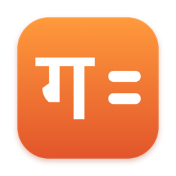

<h1 align="center">Ganit: the notepad calculator for Mac</h1>

  <b>Calculate the way you talk.</b> 
  Type math in plain English and the answer shows up on the same line as you type. 
  Ask real questions like "what % more" or "split 4 ways". It knows Indian money (lakh, crore, GST, EMI, LPA) 
  and works anywhere in the world: currencies, units and time zones.

  <a href="https://github.com/navdeep-sinver/ganit/releases/latest/download/Ganit.dmg"><b>⬇️ Download Ganit for Mac</b></a>
  &nbsp;·&nbsp; Free &nbsp;·&nbsp; macOS 14 or newer &nbsp;·&nbsp; Apple silicon and Intel

  
  
  
  

  <picture>
    <source media="(prefers-color-scheme: dark)" srcset="docs/images/hero-dark.png">
    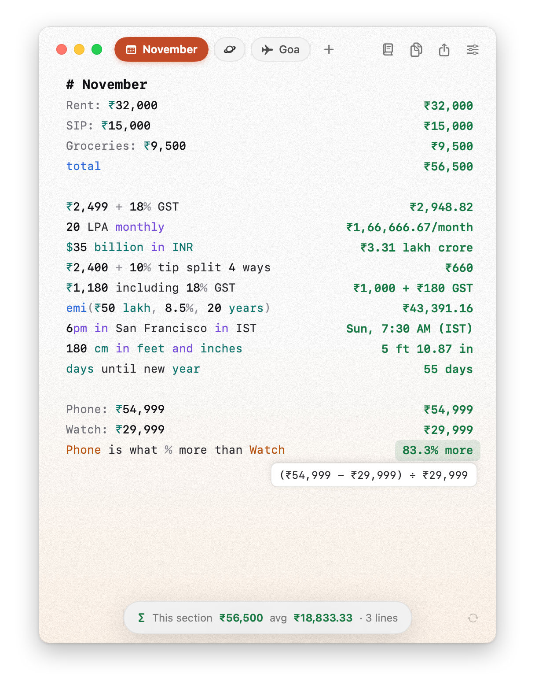
  </picture>

## What is Ganit?

**Ganit** (गणित, Hindi for "maths") is a **notepad calculator for macOS**. It's part notes app, part calculator, shaped like a notepad: tall and narrow, so it sits beside your work instead of covering it.

You type a line the way you'd say it out loud:

- `20 LPA monthly`
- `Phone is what % more than Watch`
- `₹2,400 + 10% tip split 4 ways`
- `6pm in San Francisco in IST`

The answer shows up on the right as you type. There are no formulas to learn, no spreadsheet cells and no buttons to press. Click any answer to copy it. Rest the pointer on an answer to see the math behind it.

If you've used **Soulver** or **Numi**, Ganit works the same way. It also understands how India talks about money (lakh, crore, GST, LPA, `500/-`) and answers everyday questions in plain English.

## ✨ New in 1.2

| New | What it does |
|---|---|
| 💬 **[Ask in plain English](#-ask-in-plain-english)** | "A is what % more than B", "how many times", ratio, profit and margin, GST included, split, unit price, interest |
| 🔍 **[See the math](#-see-the-math-behind-every-answer)** | Rest on any answer to see how Ganit worked it out |
| 📖 **[Phrasebook](#-phrasebook-everything-you-can-type)** | Every example in one calm drawer. Press ⌘/ and click one to add it |
| 🪐 **[Tab icons](#-tab-icons)** | Give each sheet an icon: Saturn, a pirate flag, ramen, a wallet… |
| 📝 **[Notepad shape](#what-is-ganit)** | The window now opens tall and narrow, like a real notepad |
| ⚡ **[Faster, and never quietly wrong](#-fast-light-and-never-quietly-wrong)** | Long sheets answer about a third faster. Lines it can't read get no answer, never a guess |

**Jump to:** [Questions](#-ask-in-plain-english) · [See the math](#-see-the-math-behind-every-answer) · [Phrasebook](#-phrasebook-everything-you-can-type) · [Indian money](#-money-the-way-india-talks) · [Currencies](#-currency-converter-with-fresh-rates) · [Time zones](#-time-zones-dates-and-hours) · [Units](#-unit-converter-for-everyday-things) · [Notes that add up](#-notes-that-add-up) · [Tags and budgets](#️-tags-that-add-up-track-trips-and-budgets) · [What-ifs](#️-drag-a-number-to-try-what-ifs) · [Share as a picture](#️-share-a-calculation-as-a-picture) · [Tab icons](#-tab-icons) · [Your own units](#-your-own-units-and-functions) · [Themes](#-themes-dark-mode-and-van-gogh-backgrounds) · [Download](#download-and-install) · [FAQ](#faq)

---

## 💬 Ask in plain English

Ask a question the way you'd ask a friend. Ganit picks the right formula **and** the right shape for the answer, so "what %" gives a percent, "how many times" gives a multiple and "which is cheaper" names the winner.

- **Percent more or less:** `Phone is what % more than Watch` gives 83.3% more
- **How many times:** `how many times is Phone of Watch` gives 1.83×
- **Ratio:** `ratio of Watch to Phone` gives 1 : 1.83
- **Compare:** `Phone vs Watch`, `which is cheaper, Phone or Watch`, `difference between A and B`
- **Percent change and points:** `% change from 80 to 100`, `interest went from 4% to 6%` gives +2 points (+50%)
- **Profit, margin and markup:** `bought at ₹500 sold at ₹650` gives ₹150 profit (+30%)
- **GST included:** `₹1,180 including 18% GST` gives ₹1,000 + ₹180 GST. `excluding` works too.
- **Back to the original:** `600 is 20% more than what`, `₹2,000 after 20% discount`, `20% off then 10% off on ₹2,000`
- **Split and share:** `₹2,400 + 10% tip split 4 ways`, `divide ₹1,000 in ratio 2:3`
- **Unit price:** `₹120 for 500 g` gives ₹240/kg. `5 kg costs ₹400, how much for 7 kg` gives ₹560.
- **Interest and growth:** `simple interest on ₹1 lakh at 8% for 2 years`, `compound interest on ₹1 lakh at 12% for 3 years`, `₹1 lakh to ₹2 lakh in 5 years` (yearly growth, or CAGR), `how long to double at 8%`
- **Travel and saving:** `300 km at 60 km/h`, `300 km at 15 km/l`, `how long to save ₹5 lakh at ₹20k a month`

There's **no AI** behind this. It's plain rules that run on your Mac, work offline and give the same answer every time. If Ganit can't tell what a question means, it shows no answer instead of a guess.

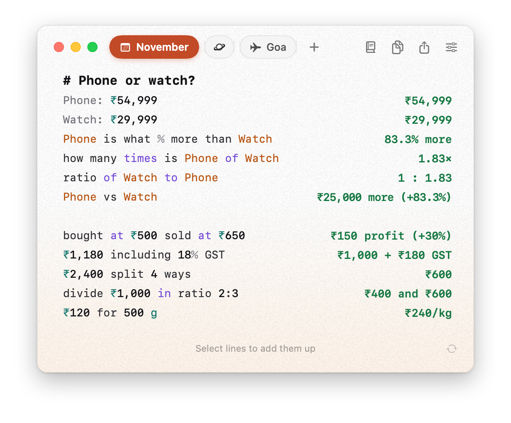

## 🔍 See the math behind every answer

Not sure how Ganit got a number? **Rest the pointer on any answer.** A slim card shows the math it did, with your numbers filled in, plus any words it skipped. You never have to wonder whether it read your line the way you meant it.

- `Phone is what % more than Watch` shows `(₹54,999 − ₹29,999) ÷ ₹29,999`
- The card only shows up when there's something to explain, and gets out of the way when you move on
- It's on from the start. Turn it off in **Settings → Look → Answers → Explain answers**.

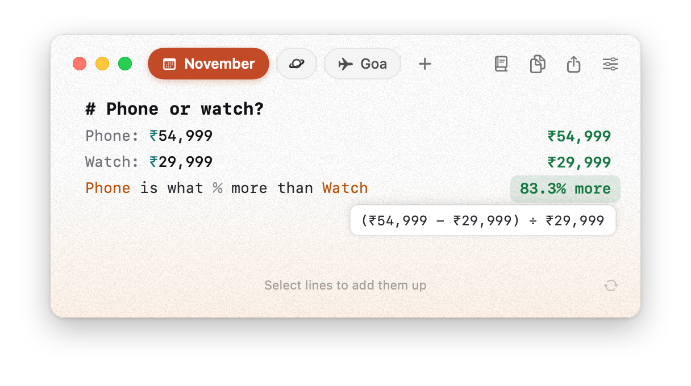

## 📖 Phrasebook: everything you can type

Wondering what Ganit understands? Press **⌘/** (or click the book button) and the **Phrasebook** slides out from behind the window. Your sheet keeps its size.

- **Every example shows its real answer**, worked out by Ganit as you look
- **Click any example to add it** to your sheet where the cursor is, with any lines it needs. One undo takes it back out.
- **Search** ("gst", "split", "emi") or pick a category: Money, Percent, Compare, Split, Shopping, Units & time and Loans
- **Tips** teach the basics in a minute: naming things, totals, tags and budgets, using the line above, your own units and formulas, notes and headings
- Also in **View → Phrasebook** and the **Help** menu

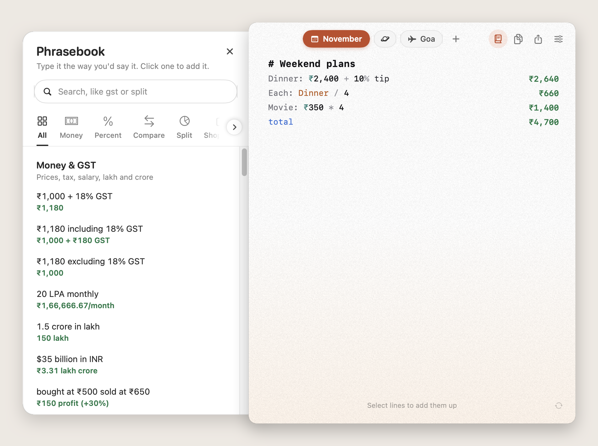

## 💰 Money, the way India talks

Ganit is a **GST calculator**, **EMI calculator**, **salary calculator** and **lakh–crore converter** in one. You don't need to switch apps for any of them.

- **GST:** `₹2,499 + 18% GST` gives ₹2,948.82. `₹1,180 including 18% GST` takes the GST back out.
- **Salary:** `20 LPA monthly` turns a yearly package into a monthly figure
- **Lakh and crore:** `1.5 crore in lakh`, `$35 billion in INR` gives ₹3.31 lakh crore
- **Loans and savings:** `emi(₹50 lakh, 8.5%, 20 years)`, `compound(₹1 lakh, 12%, 10 years)`
- **The way bills are written:** `500/- * 6`, `10% of ₹45,000`, `₹80,000 - 15%`
- **Indian number grouping** in answers, like ₹1,66,666.67. Big amounts can read as words: ₹45 crore, ₹3.31 lakh crore.

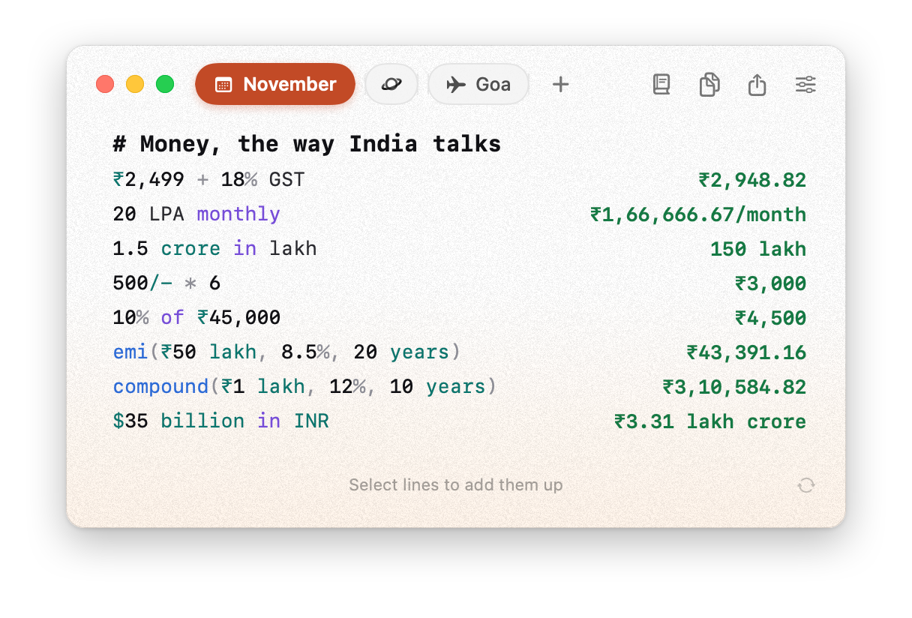

## 💱 Currency converter with fresh rates

Convert between **160+ currencies** and **12 cryptocurrencies** (BTC, ETH, SOL and more) right inside your notes. You can mix currencies in one line, too.

- `$120 in INR`
- `€50 + £20 in USD`
- `₹5 crore in USD`
- `40 hours at $45/hour in INR`
- `0.05 BTC in INR`

Rates update on a schedule you pick: hourly, every 6 hours, daily, weekly or only when you ask.

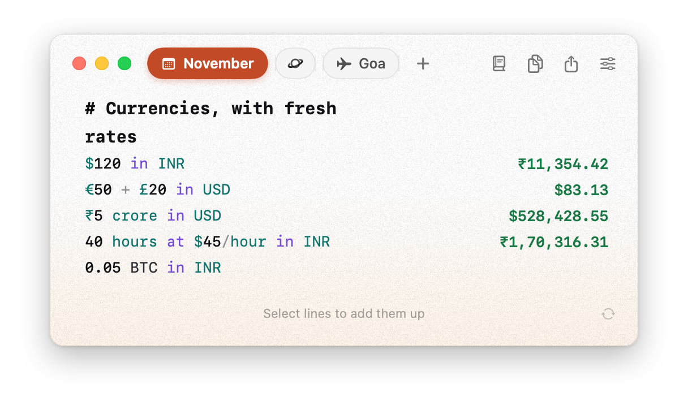

## 🕐 Time zones, dates and hours

Ganit is a **time zone converter** you can ask questions in plain English.

- `6pm in San Francisco is what time in India`, or just `6pm in San Francisco in IST`
- `9am in New York in IST`, `3pm IST in London`
- `9am to 5:30pm` gives 8 h 30 min
- `3pm + 2 hours 45 min`
- `days until new year`, `3 weeks from today`, `today + 45 days`
- Unix timestamps: `now in unix`, `fromunix(…)`

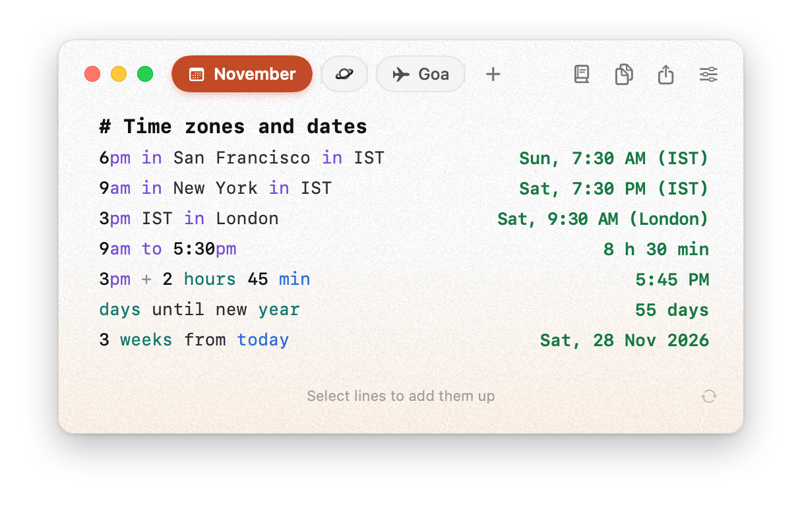

## 📏 Unit converter for everyday things

Length, weight, area, volume, temperature, speed, data and more. Write units the way you normally would.

- `180 cm in feet and inches` gives 5 ft 10.87 in
- `72 °F in °C`, `60 mph in km/h`
- `2 cups in ml`, `100 sq m in sq ft`, `1.5 GB in MB`
- `2 kg at ₹120/kg` gives ₹240

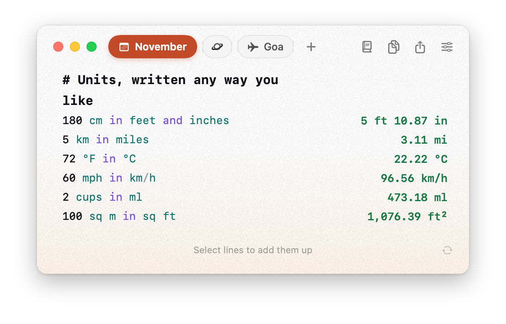

## 🧾 Notes that add up

Write a list, and Ganit keeps the running total for you.

- **Labels become names:** write `Rent: ₹25,000`, then use `Rent * 12` further down
- **`total`, `sum`, `average`** add up the lines above
- **Line references:** `line 3`, `prev`, or ⌘-click an answer to use it in the line you're typing
- **Totals bar:** select some lines to see their sum, average and count
- **Many sheets:** one for your budget, one for a trip, one for work. Switch with ⌘1–9.
- **Autocomplete** suggests your names, units, currencies and functions

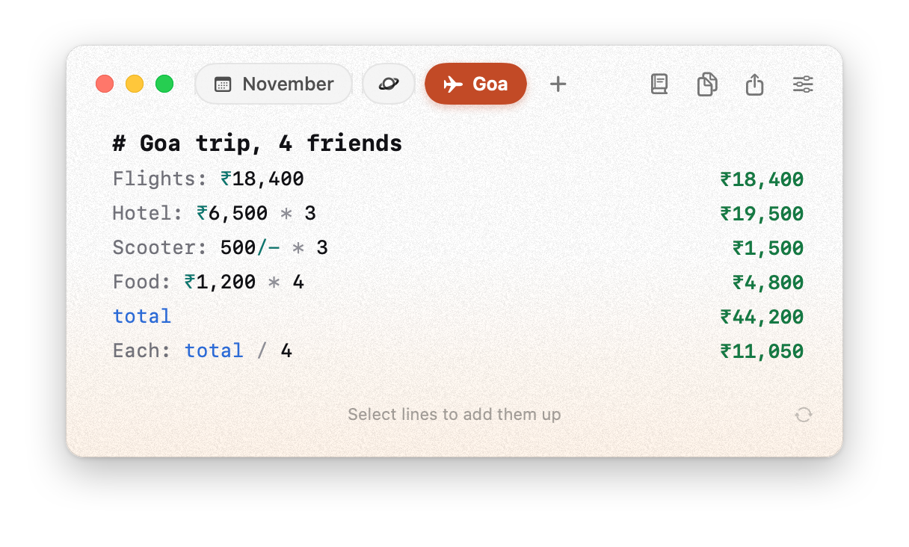

## 🏷️ Tags that add up: track trips and budgets

Track **trip expenses**, **monthly spending** or a **shared flat budget** right in your notes, without a spreadsheet or an expense app. Add a tag like `#food` or `#travel` to any line, and Ganit adds up each tag for you.

- **Tag any line:** `Dinner ₹2,400 #food`, `Flights ₹18,400 #travel`. Tags never change a line's answer.
- **A tag strip** at the bottom of the sheet shows what every tag adds up to. Click a tag to light up its lines.
- **`total #food`** adds up one tag from anywhere in the sheet. `average #food` works too.
- **Budgets:** `#food budget ₹4,000` shows **₹950 left**, with a small bar that turns orange when you go over.
- **Mixed currencies are fine:** `$100 #stay` and `₹850 #stay` add up in one currency. Things that can't be added (km and ₹) are never quietly mixed.
- Tags count **inside their own sheet**, so your Goa trip and your November budget stay separate.

Turn tags on in **Settings → Advanced**. There's a live demo right there.

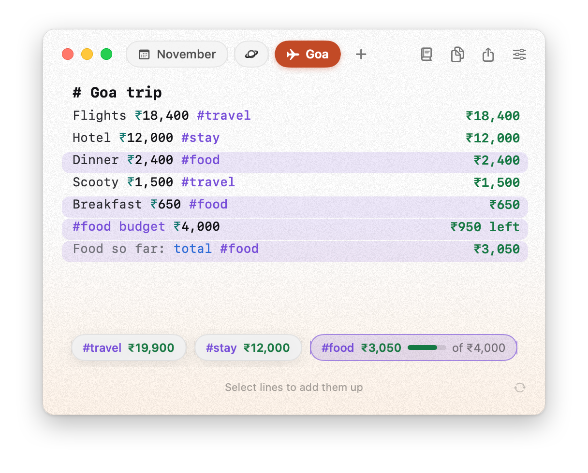

## 🎚️ Drag a number to try what-ifs

"What if the loan was 7 years instead of 5?" "What if rent went up to ₹28,000?" Hold **⌘** and drag any number left or right. Every answer that uses it changes as you drag, so you can try ideas without retyping anything.

- Great for an **EMI calculator** what-if (rate, tenure, down payment), salary hikes, SIP amounts, prices and budgets
- The step fits the number: 5 moves by 1, 8.5% by 0.1, ₹25,000 by 1,000
- Hold **⇧** to go faster or **⌥** to go finer. No mouse? Use **⌃⌥↑** and **⌃⌥↓**.
- **⌘Z** undoes the whole drag

Turn it on in **Settings → Advanced**.

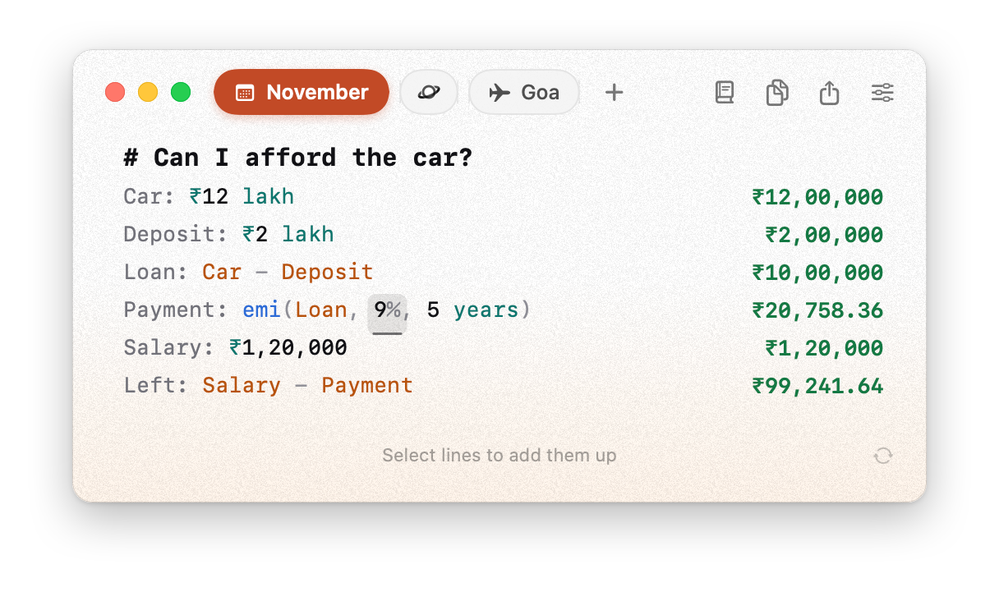

## 🖼️ Share a calculation as a picture

Send a bill split, a trip total or a budget to friends on **WhatsApp**, **Messages** or **Mail** as a clean picture, in your own theme.

- Click the **share button**, then **Copy as Picture** (or press **⌃⌘C**) and paste it anywhere
- **Save as Picture** or **Share Picture** (AirDrop, Messages, Mail and more) from the same menu
- Select some lines first to share **just those lines**
- Tag totals and budgets come along at the bottom
- **Export as PDF** and **copy as text with answers** are still there too

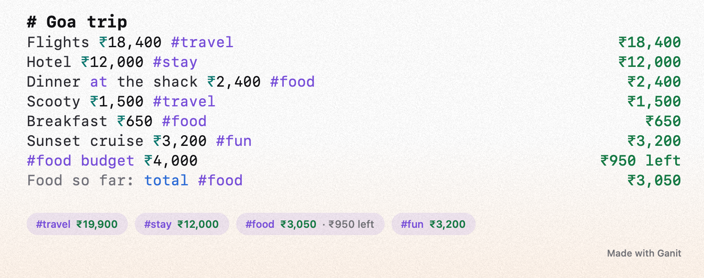

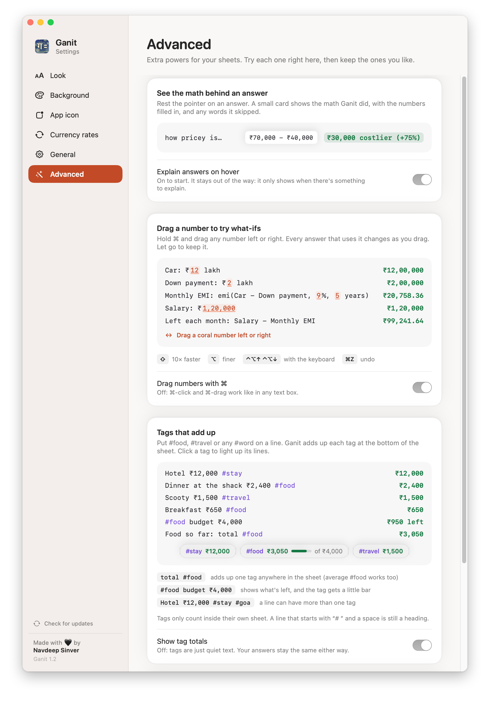

## 🪐 Tab icons

Every sheet gets a tab at the top. Now each tab can have its own **icon**, so you can spot your budget, your trip or your side project at a glance.

- **Double-click a tab** to rename it, then **click its icon**. A small card drops down.
- **Fun** icons: space (Saturn, a rocket, a comet, a UFO), pirates, ninjas, legends, calm, play, animals, art and music, and nature
- **Useful** icons: money, home, travel, work, food and math
- **120 icons** in all, all in one clean black style. Click one and the card closes. **Reset** brings back the plain icon.
- **Icon only:** once a tab has an icon, you can leave its name blank and the tab shows just the icon
- A plain click on a tab still just switches sheets
- Icons are kept outside your `.txt` files, so your sheets stay plain text. They follow renames and duplicates.

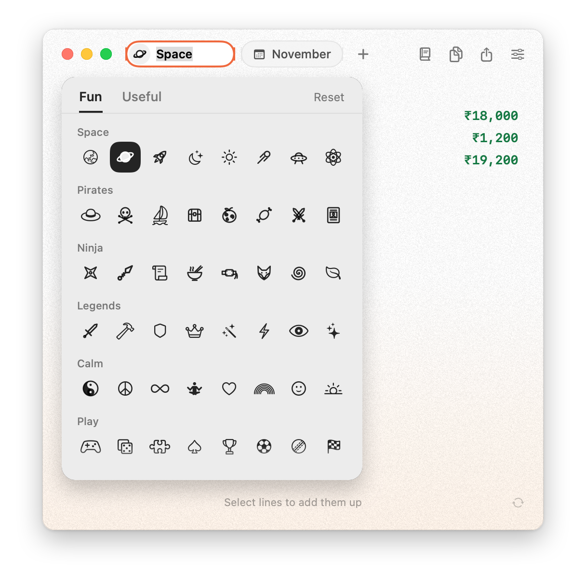

## ✨ Your own units and functions

Teach Ganit the words you use.

- **Your own units:** `1 bigha = 2529 sq m`, then `5 bigha in acres`
- **Your own functions:** `tip(x) = x * 15%`, then `tip(₹2,400)`
- **A Definitions sheet:** anything you define there works in every sheet

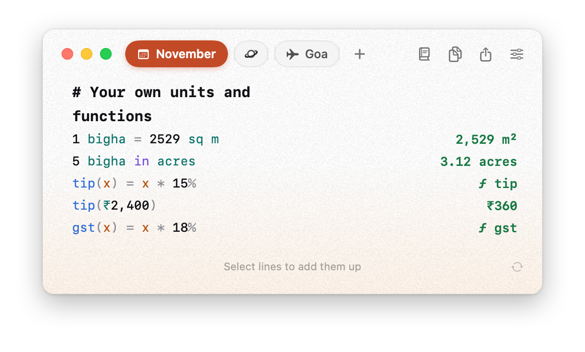

## 🧮 Quick math and programmer tools

`sqrt(144) + 10%`, powers (`2^10`), factorials (`5!`), percentages, `255 in hex`, binary and octal. `$5B` and `1_000_000` work too.

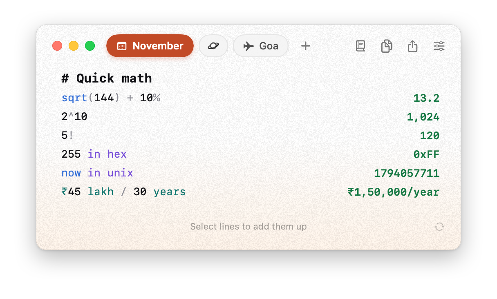

## 🎨 Themes, dark mode and Van Gogh backgrounds

Make it look the way you like.

- **8 colour themes**, each with light and dark mode, and your own colour for every part
- **11 Van Gogh paintings** as backgrounds, like *The Starry Night*, *Café Terrace at Night*, *Almond Blossom* and *Irises*. Each one is softened, with text colours checked so every line is easy to read.
- **Any font on your Mac**, plus text size, line spacing and decimal places
- **26 app icons** to choose from

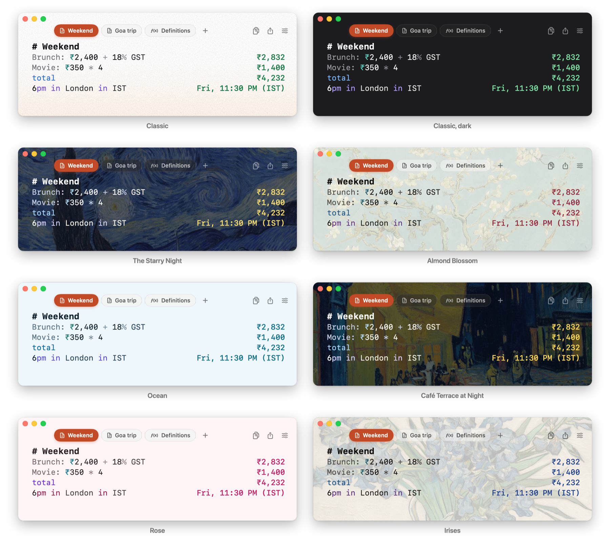

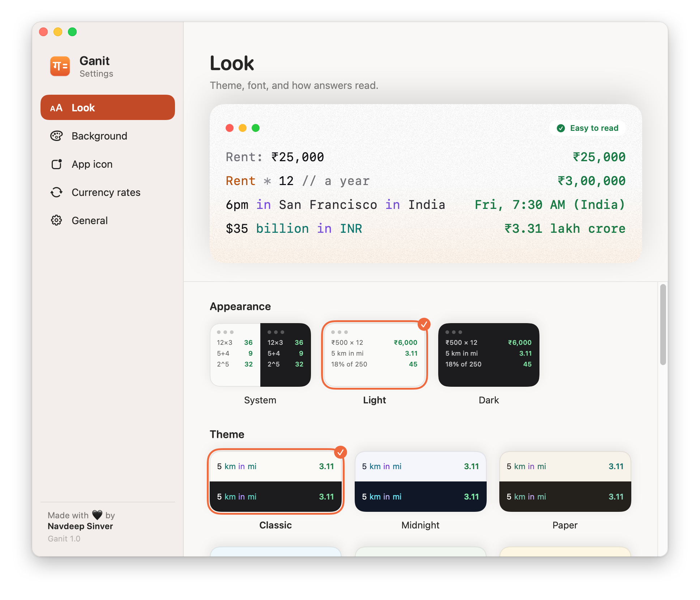

## ⌨️ Always one shortcut away

- Press **⌃⌥Space** in any app to show or hide Ganit. You can change the shortcut.
- **A 10-second lesson** teaches it the first time you open Ganit: hold each key as it lights up, and you're done.
- It lives in the **menu bar**, so you can keep it out of the Dock.
- **Export** a sheet as a PDF (⇧⌘E), print it (⌘P), or copy it with its answers (⌥⌘C).
- **`ganit-cli`** brings the same maths to Terminal, Raycast, Alfred and scripts: `ganit-cli "5 km in miles"`.

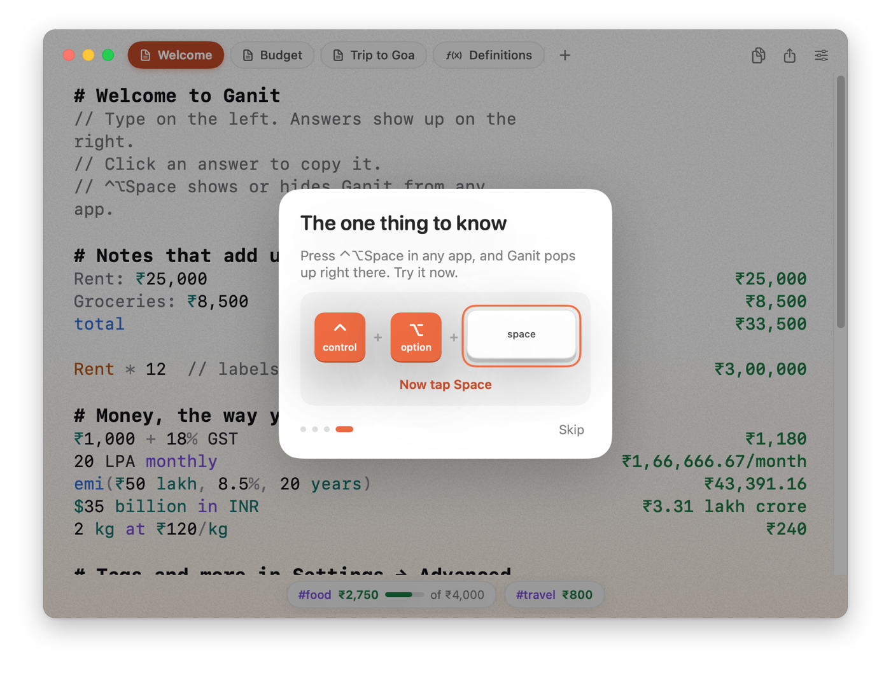

## ⚡ Fast, light and never quietly wrong

- **Fast:** a long sheet (1,000 lines) works out about a third faster than in Ganit 1.1, and typing stays smooth
- **Light:** about 50 MB of memory. The Phrasebook only takes memory while it's open.
- **Never quietly wrong:** if a question can't be read, Ganit leaves the answer blank instead of guessing. Lines like `20% less than 500` and `300 km at 60 km/h` that used to come out wrong now give the right answer.
- **Honest totals:** things that can't be added (km and ₹) are never quietly mixed

## 🔒 Your notes stay yours

- Sheets are **plain `.txt` files** in a folder you choose. Pick a folder in **iCloud Drive** to sync between Macs.
- **Daily backups**, kept for 14 days
- **No account. No tracking. No AI.** Ganit only goes online to fetch currency rates and to check for updates.
- **Updates itself:** new versions download in the background, and one click restarts into them.

---

## What's new in 1.2

- 🪐 **Tab icons:** double-click a tab, then pick an icon
- 💬 **Ask in plain words:** "what % more than…", ratio, profit, GST included, split, unit price, interest
- 📖 **Phrasebook:** every example, one click away (⌘/)
- 🔍 **See the math:** rest on any answer
- 📝 **Notepad shape:** new windows open tall and narrow
- ⚡ **Faster, and never quietly wrong**

<b>What was new in 1.1</b>

- **Share any sheet as a picture**, ready for WhatsApp
- **Settings → Advanced:** `#tags` that add up, budgets, and ⌘-drag numbers for what-ifs
- **A quick hands-on lesson** for the ⌃⌥Space shortcut
- The **Settings preview** now shows every change (decimal places, line spacing, size, bold)
- Works better with **Stage Manager**, and **Esc** closes Settings

Every version's notes are on the [Releases page](https://github.com/navdeep-sinver/ganit/releases). Ganit updates itself, so you get new versions automatically.

## Download and install

1. **[Download Ganit.dmg](https://github.com/navdeep-sinver/ganit/releases/latest/download/Ganit.dmg)** (about 18 MB).
2. Open it and drag **Ganit** into **Applications**.
3. Open Ganit. Because it isn't from the App Store yet, macOS asks first:
   - Click **Done** on the warning.
   - Open **System Settings → Privacy & Security**, scroll down, and click **Open Anyway**.
4. That's it. After this first time, Ganit opens normally and keeps itself up to date.

Works on **macOS 14 Sonoma or newer**, on **Apple silicon (M1, M2, M3, M4 and later)** and **Intel** Macs.

## Keyboard shortcuts

| Shortcut | What it does |
|---|---|
| ⌃⌥Space | Show or hide Ganit from any app |
| ⌘/ | Open or close the Phrasebook |
| ⌘N | New sheet |
| ⌘1 – ⌘9 | Switch sheets |
| Double-click a tab | Rename it, or click its icon to pick a new one |
| Click an answer | Copy it |
| Rest on an answer | See the math behind it |
| ⌘-click an answer | Use it in the line you're typing |
| Esc | Show units, currencies and functions |
| ⌘F | Find and replace |
| ⌥⌘C | Copy the sheet with its answers |
| ⌃⌘C | Copy the sheet as a picture |
| ⌘-drag a number | Try other values (Settings → Advanced) |
| ⌃⌥↑ / ⌃⌥↓ | Nudge the number at the cursor |
| ⇧⌘E | Export as PDF |
| ⌘P | Print |

## FAQ

**Is Ganit free?**
Yes. Ganit is free to download from this page.

**Does Ganit work on Intel Macs and Apple silicon Macs?**
Yes. It's one app that runs natively on both. You need macOS 14 Sonoma or newer.

**Is Ganit an alternative to Soulver or Numi?**
Yes. It's the same notepad-calculator idea. Ganit also answers questions in plain English ("what % more", "how many times", "split 4 ways"), shows the math behind every answer, understands Indian money words (lakh, crore, LPA, GST, `500/-`) and gives answers in Indian number grouping.

**Does Ganit use AI?**
No. It reads your lines with plain rules that run on your Mac. It works offline, gives the same answer every time, and never sends your notes anywhere. If it can't tell what a line means, it shows no answer instead of a guess.

**How do I find what percent more one price is than another?**
Name the two prices, then ask. For example `Phone: ₹54,999`, `Watch: ₹29,999`, then `Phone is what % more than Watch`. Ganit answers 83.3% more. You can also type numbers straight in: `30 is what % of 120`.

**How do I calculate GST on a Mac?**
Type `₹1,000 + 18% GST` in Ganit. For the tax alone, type `18% of ₹1,000`.

**How do I remove GST from a price that already includes it?**
Type `₹1,180 including 18% GST`. Ganit shows ₹1,000 + ₹180 GST. `₹1,180 excluding 18% GST` gives just the ₹1,000.

**How do I convert LPA salary to monthly?**
Type `20 LPA monthly`. Ganit shows ₹1,66,666.67/month.

**How do I calculate a home loan EMI?**
Type `emi(₹50 lakh, 8.5%, 20 years)`. That's the loan amount, the yearly interest rate and the number of years.

**How do I work out profit and margin?**
Type `bought at ₹500 sold at ₹650` for profit and markup, or `cost ₹600 price ₹1,000 margin` for the margin.

**How do I split a bill with friends?**
Type `₹2,400 + 10% tip split 4 ways`. To split unevenly, type `divide ₹1,000 in ratio 2:3`.

**How do I compare prices per kg?**
Type `₹120 for 500 g` to get ₹240/kg. For a bigger pack, `5 kg costs ₹400, how much for 7 kg`.

**How long does it take to double my money?**
Type `how long to double at 8%`. For yearly growth between two amounts, type `₹1 lakh to ₹2 lakh in 5 years`.

**How do I see how Ganit got an answer?**
Rest the pointer on the answer. A small card shows the math with your numbers filled in. It's on from the start (Settings → Look → Answers → Explain answers).

**Where can I see everything Ganit understands?**
Press ⌘/ to open the Phrasebook. It has every kind of line Ganit reads, each with its real answer. Click one to add it to your sheet.

**Can I give a sheet tab an icon?**
Yes. Double-click the tab, then click its icon to pick one of 120. Once a tab has an icon, you can leave its name blank.

**How do I try a different interest rate or loan tenure quickly?**
Turn on **Drag numbers** in Settings → Advanced. Then hold ⌘ and drag the rate or the years left and right, and watch the EMI change.

**How do I track trip expenses or a monthly budget?**
Add tags like `#food`, `#travel` or `#stay` to your lines (turn on **Tags** in Settings → Advanced). Ganit adds up each tag at the bottom of the sheet. Write `#food budget ₹4,000` to see how much is left.

**Can I share a calculation on WhatsApp?**
Yes. Click the share button and choose **Copy as Picture** (⌃⌘C), then paste it into WhatsApp, Messages or Mail. Select some lines first to share only those.

**Does it work offline?**
Yes. Everything works offline except fresh currency rates. Ganit uses the last rates it saved until it can get new ones.

**Where are my notes saved?**
As `.txt` files in a folder you pick in Settings. They're plain text, so any app can open them.

**Why does macOS warn me the first time I open it?**
Ganit isn't in the App Store yet, so macOS asks you to confirm once. Follow the steps in [Download and install](#download-and-install).

## Feedback

Found a line Ganit should understand, or a bug? [Open an issue](https://github.com/navdeep-sinver/ganit/issues). Ideas are welcome too.

  Made with 🖤 by Navdeep Sinver

